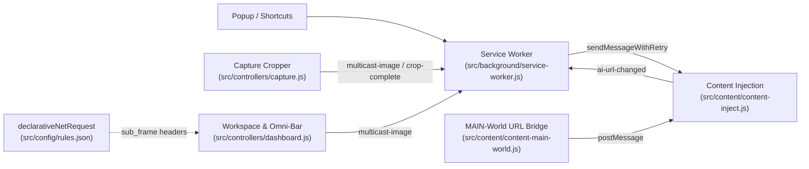

<div align="center">
  
  <h1>Yui.AI</h1>
  <p>Multi-AI workspace extension for Chromium (ChatGPT, Claude, and Gemini) with screen capture and broadcast submit.</p>

  <p>
    <a href="https://hub.xerj.org/contributors/NakunaruZeno"></a>
    
  </p>
</div>

## Overview

Yui.AI embeds ChatGPT, Claude, and Gemini side-by-side in a single Chromium workspace so you don't have to switch tabs to compare answers. You can capture a screen region, attach a prompt, and send both to all open AI panels at once.

The UI takes cues from the Cardinal/Aincrad HUD in *Sword Art Online*, kept minimal with dark and light themes.

## Features

- **Split-pane workspace (1 / 2 / 3 columns):** Switch between single-panel focus and split views without reloading background iframes. Drag dividers to resize, or double-click a divider to reset equal widths.
- **Omni-command bar & Ring HUD:** Type one prompt or paste an image (`Ctrl+V`) in the bottom bar to broadcast to all active panels, or pick a single target from the radial menu.
- **Screen capture & crop:** Captures the active tab via `chrome.tabs.captureVisibleTab` and crops at native device resolution (`devicePixelRatio`-aware). From the crop bar you can send immediately, add a quick prompt, copy to clipboard, or stage into the dashboard.
- **Per-provider DOM injection:**
  - ChatGPT: `drop_to_upload` + synthetic paste for ProseMirror/React.
  - Claude: hidden file input (`paste_to_upload`) + ProseMirror paste.
  - Gemini: editor paste (`paste_to_input`) + input-state trigger for Quill/Angular.
- **Session persistence:** A `MAIN`-world bridge tracks `window.navigation` and `history.pushState`/`replaceState` inside AI frames so active chat URLs are restored on reopen. Use `+ New` on a panel header to start a fresh thread.

## Architecture



## Project Structure

```text
Yui.AI/
├── manifest.json
├── assets/icons/
│   ├── logo.svg
│   └── icon{16,32,48,128}.png
├── src/
│   ├── background/service-worker.js
│   ├── config/rules.json
│   ├── content/
│   │   ├── content-inject.js
│   │   └── content-main-world.js
│   └── controllers/
│       ├── capture.js
│       ├── dashboard.js
│       └── popup.js
└── ui/
    ├── styles/
    │   ├── capture.css
    │   ├── dashboard.css
    │   ├── popup.css
    │   └── sao-theme.css
    └── views/
        ├── capture.html
        ├── dashboard.html
        └── popup.html
```

## Setup

1. Clone this repository:
   ```bash
   git clone https://github.com/NakunaruZeno/Yui.AI.git
   ```
2. Open `chrome://extensions/` in Chrome, Edge, or Brave and turn on **Developer mode**.
3. Click **Load unpacked** and select the `Yui.AI` folder.
4. Make sure you are signed in to [chatgpt.com](https://chatgpt.com), [claude.ai](https://claude.ai), and [gemini.google.com](https://gemini.google.com) in the same browser profile.

## Shortcuts

| Shortcut | Where | Action |
| :--- | :--- | :--- |
| `Ctrl+Shift+Y` (`Cmd+Shift+Y`) | Global | Open or focus the workspace |
| `Ctrl+Shift+X` (`Cmd+Shift+X`) | Global | Capture active tab and open cropper |
| `Enter` | Cropper / Omni-bar | Send to all active panels |
| `Space` | Cropper | Select full viewport |
| `Esc` | Cropper / Workspace | Reset crop, cancel capture, or close overlay |
| `Ctrl+V` (`Cmd+V`) | Workspace | Paste clipboard image into the command bar |
| `Double-click divider` | Workspace | Equalize column widths |

## License

See [LICENSE](LICENSE).
