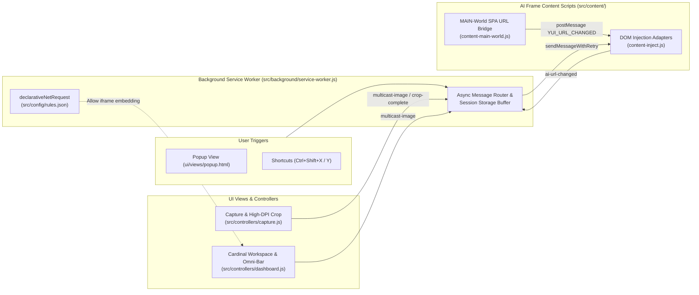

<div align="center">
  

  <h1>Yui.AI</h1>
  <p><strong>Minimalist SAO Cardinal Workspace — Multi-AI Orchestration, High-DPI Screen Capture &amp; Auto-Submit Extension</strong></p>

  <p>
    
    
    
    
  </p>

  <p>
    <a href="#-english">English</a> •
    <a href="#-tiếng-việt">Tiếng Việt</a> •
    <a href="#-日本語">日本語</a>
  </p>
</div>

---

<div id="-english"></div>

## 🌐 Overview

**Yui.AI** is a Chromium browser extension (Manifest V3) engineered for developers, researchers, and power users who work concurrently across **ChatGPT**, **Claude**, and **Gemini**. Inspired by the **Cardinal System** and **Yui** from *Sword Art Online*, it unifies multiple AI web interfaces into a single split-pane HUD workspace with lossless screen capture, inline prompt broadcasting (**All-Link Start**), and automatic SPA chat session persistence.

---

## ⚡ Core Capabilities

### 1. Cardinal Multi-AI Split-Pane Workspace
- **Concurrent AI Nodes:** Run ChatGPT, Claude, and Gemini side-by-side inside a unified workspace without switching browser tabs.
- **Non-Destructive Layout Modes (`1` / `2` / `3` Columns):** Switch instantaneously between **Focus Mode** (1 column), **Dual Split** (2 columns), and **Triple Link** (3 columns) while keeping background iframes alive in the DOM—preventing reloads or interrupted streams.
- **Proportional Flex Resizing:** Drag column dividers smoothly or **double-click** any divider to equalize column widths.
- **Per-Node Session Controls:** Start a fresh conversation (`+ New`), toggle single-node maximize, reload, or pop any active conversation out into a standalone browser tab.

### 2. All-Link Omni-Command Bar
- **Unified Prompt & Image Broadcast:** Type a prompt once or paste an image (`Ctrl+V`) directly into the bottom Omni-Command Bar and broadcast it to all linked AIs simultaneously (or target a specific AI via the **Radial Ring HUD**).
- **Quick Prompt Presets:** One-click prompt chips (`Explain`, `Debug`, `Summarize`) for rapid engineering and study workflows.

### 3. Lossless High-DPI Screen Capture & Spotlight Crop
- **Native-Resolution Extraction:** Captures the active viewport via `chrome.tabs.captureVisibleTab` and maps CSS selection coordinates back to native device pixels (`devicePixelRatio`-aware) for razor-sharp code, formula, and UI screenshots.
- **Spotlight Cutout HUD:** Keeps the selected crop region at 100% brightness while dimming the surrounding screen, complete with live pixel dimension readouts.
- **Floating Post-Crop Command Bar:** Attach an optional instruction, trigger **All-Link Start (`Enter`)**, dispatch to a single AI node, stage in the Dashboard, or copy the cropped PNG directly to the system clipboard.

### 4. Framework-Aware DOM Injection & Session Persistence
- **Cross-Framework Auto-Submit:** Uses tailored injection strategies per provider—`drop_to_upload` & synthetic clipboard paste for ChatGPT (ProseMirror/React), hidden file input `paste_to_upload` for Claude, and `paste_to_input` + input-state activation for Gemini (Quill/Angular).
- **MAIN-World SPA URL Tracker:** Intercepts `window.navigation` and `history.pushState`/`replaceState` inside AI frames to persist active conversation URLs to `chrome.storage.local`, resuming your exact chat threads across restarts.

### 5. Minimalist SAO "Cardinal" Design System
- **Architectural HUD Aesthetic:** Built with precision vector SVGs, canonical 3px SAO left accent indicators, **Cardinal Obsidian** (Dark Mode) and **Aincrad Ivory Glass** (Light Mode), with full keyboard focus visibility and `prefers-reduced-motion` support.

---

## 🏗️ Architecture



---

## 📂 Project Structure

```text
Yui.AI/
├── manifest.json                 # Chrome Extension Manifest V3 entry point
├── README.md
├── LICENSE
├── assets/
│   └── icons/
│       ├── logo.svg              # Vector SAO Cardinal Crystal emblem (transparent)
│       └── icon{16,32,48,128}.png
├── src/                          # Core Logic, Controllers & Network Rules
│   ├── background/
│   │   └── service-worker.js     # Service worker: tab discovery, capture buffer, multicast
│   ├── config/
│   │   └── rules.json            # declarativeNetRequest rules (sub_frame XFO/CSP strip)
│   ├── content/
│   │   ├── content-inject.js     # ES6 DOM injection adapters for ChatGPT, Claude, Gemini
│   │   └── content-main-world.js # MAIN-world Navigation/History API URL tracker
│   └── controllers/
│       ├── popup.js              # Popup status & launcher logic
│       ├── capture.js            # High-DPI lossless spotlight cropper logic
│       └── dashboard.js          # Split-pane workspace & Omni-Command Bar logic
└── ui/                           # Presentation Layer (HTML Views & CSS Design System)
    ├── styles/
    │   ├── sao-theme.css         # Minimalist SAO Cardinal design tokens (Dark & Light)
    │   ├── popup.css             # Compact popup HUD stylesheet
    │   ├── capture.css           # Target acquisition & spotlight cropper stylesheet
    │   └── dashboard.css         # Split-pane workspace & Omni-Command Bar stylesheet
    └── views/
        ├── popup.html            # Extension toolbar popup view
        ├── capture.html          # Fullscreen spotlight capture view
        └── dashboard.html        # Cardinal Multi-AI workspace view
```

---

## 🚀 Installation & Usage

1. **Clone the repository:**
   ```bash
   git clone https://github.com/NakunaruZeno/Yui.AI.git
   ```
2. **Load in Chrome / Edge / Brave / Opera:**
   - Navigate to `chrome://extensions/`
   - Enable **Developer mode** (top-right toggle)
   - Click **Load unpacked** and select the `Yui.AI` directory
3. **Authenticate your AI accounts:**
   - Log into [chatgpt.com](https://chatgpt.com), [claude.ai](https://claude.ai), and [gemini.google.com](https://gemini.google.com) in your browser.
4. **Launch Workspace:**
   - Press `Ctrl+Shift+Y` (or click the extension icon → **Open Link Workspace**).
   - Press `Ctrl+Shift+X` on any webpage to capture, crop, add an optional prompt, and press `Enter` to trigger **All-Link Start**.

---

## ⌨️ Keyboard Shortcuts

| Shortcut | Context | Action |
| :--- | :--- | :--- |
| `Ctrl+Shift+Y` (`Cmd+Shift+Y`) | Global | Open or focus the Yui.AI Cardinal Workspace |
| `Ctrl+Shift+X` (`Cmd+Shift+X`) | Global | Capture active tab & open Spotlight Cropper |
| `Enter` | Capture / Omni-Bar | Confirm crop & broadcast via **All-Link Start** |
| `Space` | Capture | Lock full-screen region for broadcast |
| `Esc` | Capture / Dashboard | Reset current crop selection, cancel capture, or close modals |
| `Ctrl+V` (`Cmd+V`) | Dashboard | Paste image from clipboard directly into the Omni-Command Bar |
| `Double-Click Divider` | Dashboard | Equalize split-pane column widths |

---

<details>
<summary><h2 id="-tiếng-việt">🇻🇳 Tiếng Việt (Nhấn để mở rộng)</h2></summary>

### Giới thiệu
**Yui.AI** là tiện ích mở rộng trình duyệt (Manifest V3) lấy cảm hứng từ hệ thống **Cardinal** và trợ lý **Yui** trong *Sword Art Online*. Dự án giúp hợp nhất **ChatGPT**, **Claude** và **Gemini** vào một không gian làm việc đa luồng (Split-pane Workspace) tối giản, kết hợp công cụ chụp/cắt màn hình độ phân giải gốc (High-DPI Lossless Crop) và tự động điền + gửi đồng loạt (**All-Link Start**).

### Tính năng nổi bật
- **Không gian làm việc đa luồng (1 / 2 / 3 cột):** Chuyển đổi tức thì giữa chế độ Tập trung (1 cột) và Chia đôi/Chia ba màn hình mà không làm tải lại (reload) các khung chat AI.
- **Thanh lệnh hợp nhất (All-Link Omni-Command Bar):** Nhập câu lệnh hoặc dán ảnh (`Ctrl+V`) một lần dưới đáy Dashboard để gửi đồng thời tới tất cả các AI đang mở, hoặc chọn gửi riêng qua menu vòng tròn **Ring HUD**.
- **Chụp & Cắt màn hình Spotlight sắc nét:** Tự động đồng bộ tỷ lệ màn hình (`devicePixelRatio`), cho phép gõ kèm câu hỏi hoặc chọn chip gợi ý (`Explain`, `Solve`, `Debug`, `Translate`) ngay sau khi khoanh vùng ảnh.
- **Tự động lưu phiên hội thoại (Session Persistence):** Theo dõi URL thời gian thực trong từng khung AI để khôi phục đúng đoạn chat đang dang dở, kèm nút `+ New` khi muốn mở hội thoại mới.

</details>

<details>
<summary><h2 id="-日本語">🇯🇵 日本語 (クリックして展開)</h2></summary>

### 概要
**Yui.AI** は、『ソードアート・オンライン』の「カーディナル・システム」と「ユイ」から着想を得た、ミニマリスト仕様のマルチAI統合Chrome拡張機能（Manifest V3）です。**ChatGPT**、**Claude**、**Gemini** を単一のスプリットペイン・ワークスペースで同時に操作し、高解像度スクリーンキャプチャや一括プロンプト送信（**All-Link Start**）をシームレスに実行できます。

### 主な機能
- **マルチAIスプリットワークスペース（1 / 2 / 3カラム切替）:** iframeを再読み込みすることなく、フォーカスモード（1列）と分割表示（2〜3列）を瞬時に切り替え可能。
- **All-Link オムニコマンドバー:** ダッシュボード下部のコマンドバーから、テキストプロンプトやクリップボード画像（`Ctrl+V`）を全AIノードへ一斉送信。
- **ロスレス高DPIキャプチャ＆スポットライトクロップ:** `devicePixelRatio` に対応した鮮明な領域切り抜きと、直後のフローティングバーからの即時プロンプト添付・一括送信。
- **チャットセッション永続化:** SPAナビゲーションを自動追跡し、次回起動時も直前の会話スレッドを正確に再開。

</details>

---

<div align="center">
  <sub>Architected with precision • Inspired by Aincrad &amp; Cardinal System</sub>
</div>
